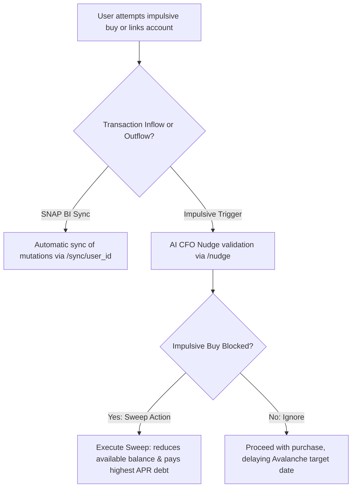
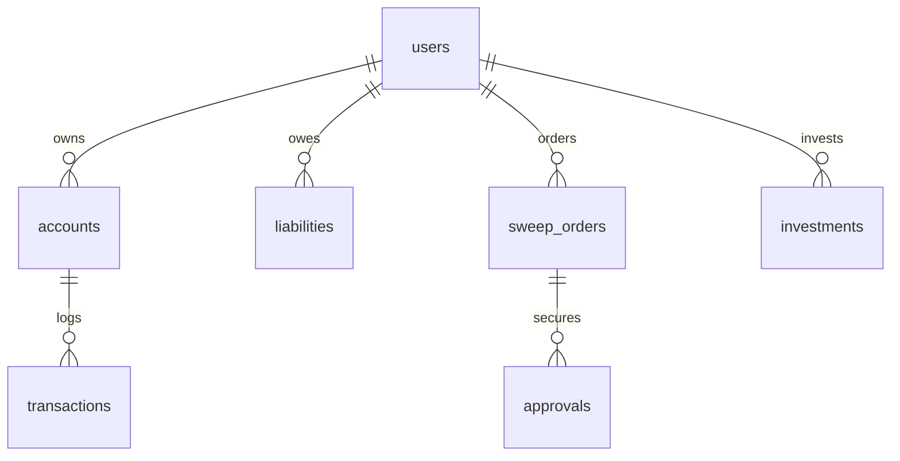

# LUNAS - System Flow & Documentation

This document describes the exact architecture, user journeys, data flows, page structures, and business logic of the **LUNAS** application (personal financial assistant and auto-sweep system). It serves as a single source of truth for developers and AI assistants to understand, build, and maintain the application.

---

## 1. Executive Summary & Core Value Proposition

### 1.1 What is LUNAS?
**LUNAS** is an algorithm-driven personal finance guardian designed with a **Zero-Friction** approach. Unlike traditional expense trackers that require tedious manual logging, LUNAS automates data aggregation through open banking integrations, analyzes transaction patterns, and guides users toward debt freedom and wealth growth. 

At its core, LUNAS acts as an autonomous Chief Financial Officer (CFO) for everyday users—detecting impulsive spending, calculating safety buffers, and recommending instant one-tap debt repayments or investment top-ups.

### 1.2 Target Users & Core Problems Solved
LUNAS targets three distinct user profiles facing critical financial challenges:

1. **Freelancers & Daily Gig Workers (Arus Kas Harian):**
   * **Problem:** Highly volatile income makes budgeting difficult, leading to accidental spending of tax reserves or emergency money.
   * **LUNAS Solution:** Dynamically computes and locks a **Safe Daily Budget** and **Daily Living Buffer (Safe Buffer)**, ensuring non-essential spending does not eat into essential reserves.

2. **Debt-Stressed Users (Fokus Bebas Utang):**
   * **Problem:** High-interest micro-loans (Paylater, Online Loans) pile up, and users struggle to find the most efficient repayment strategy.
   * **LUNAS Solution:** Automatically groups, tracks, and prioritizes debts using the **Avalanche Method** (repaying highest interest APR first) and triggers smart "CFO Nudges" to block impulsive purchases and redirect money to debt.

3. **Wealth Accumulators (Fokus Kembangkan Dana):**
   * **Problem:** Cash sits idle in zero-interest accounts due to lack of investment decision-making.
   * **LUNAS Solution:** Evaluates surplus funds beyond the safety buffer and recommends optimal top-ups to high-performing active assets (Mutual Funds, Bonds, Blue Chip Stocks).

---

## 2. Application Architecture & Page Mapping

LUNAS is designed as a **Mobile-First Responsive Web Application** built using **Next.js (App Router)** and supported by a **Python FastAPI Backend** and a companion **Flutter Mobile App**.

### 2.1 Web Route Map (App Router)
* **`/` (Main Dashboard):** Displays dynamic widgets based on profile type, balance summaries, allocation charts, and recent transaction history.
* **`/debt` (Debt Tracker):** Displays the debt avalanche dashboard, outstanding priorities, and interactive repayment drawers.
* **`/wealth` (Portfolio & Growth):** Houses asset allocation charts, performance recommendations, and instant top-up drawers.
* **`/profile` (Settings & Demo Console):** Manages user preferences, safe buffer limit settings, and demo state reset controls.

### 2.2 Component Hierarchy by Screen

#### Root Layout Structure
```text
RootLayout (app/layout.tsx)
 └── AppProvider (context/AppContext.tsx)
      └── MobileContainer (components/layout/MobileContainer.tsx) [Max width 120 / max-w-md]
           └── AppLayout (components/layout/AppLayout.tsx)
                ├── ONBOARDING STATE: OnboardingWizard.tsx
                └── APP STATE: Page Component + BottomNav + SmartActionModal
```

#### Onboarding Screen Hierarchy
```text
OnboardingWizard (components/onboarding/OnboardingWizard.tsx)
 ├── Navigation Header (Progress bar & Step counter 1-4)
 └── Current Step Viewport:
      ├── Step 0: WelcomeStep (Intro & value prop)
      ├── Step 1: AuthStep (Google OAuth or email validation)
      ├── Step 2: ProfilingStep (Interactive focus selector card)
      ├── Step 3: ConnectBankStep (SNAP BI institution linker)
      └── Step 4: BufferSetupStep (Safe Buffer range slider)
```

#### Main Dashboard (`/` Route) Hierarchy
```text
Dashboard (app/page.tsx)
 ├── Header Section (User avatar, sapaan name, profile focus badge)
 ├── Bento Grid Summary Cards (Net Worth Highlight, Liquidity Available Balance)
 ├── Bento Grid Analytics (DonutChart: Asset Allocation, BarChart: Weekly Cashflow)
 ├── Dynamic Profile Widgets (Conditional on userProfile.profileType):
 │    ├── Freelancer: ProgressBar (Daily Spent vs. Safe Daily Budget) + Stability Nudge
 │    ├── Debt Focus: Avalanche Priority Target Alert + 1-Tap Repay Action Button
 │    └── Wealth Focus: Estimate Portfolio Card + Active Assets Summary
 └── Recent Transactions List (Clean List Spacing, avatar icons, amount sign coloring)
```

#### Debt Tracker Dashboard (`/debt` Route) Hierarchy
```text
DebtPage (app/debt/page.tsx)
 ├── Page Header (Avalanche Optimization title)
 ├── Total Outstanding Card (Neo-Bento Dark theme card, ProgressBar showing lunas percentage)
 ├── Prioritas Utama Banner (Highlights highest APR active debt)
 └── Debts Interactive List:
      └── Debt Item Card (APR Badge, Due date, Outstanding progress bar)
           └── [ACTIVE STATE]: Repayment Drawer (Balance display, custom range slider, 1-Tap Pay button)
```

#### Wealth Portfolio Dashboard (`/wealth` Route) Hierarchy
```text
WealthPage (app/wealth/page.tsx)
 ├── Page Header (Wealth Growth Engine title)
 ├── Donut Chart Card (Asset distribution visualizer & return rates)
 ├── Optimization Recommendation Banner (Highlights highest return rate asset)
 └── Assets Interactive List:
      └── Asset Item Card (Category, return rate p.a., portfolio share percentage)
           └── [ACTIVE STATE]: Top-Up Drawer (Balance display, custom range slider, Top-Up button)
```

#### Profile & Settings Screen (`/profile` Route) Hierarchy
```text
ProfilePage (app/profile/page.tsx)
 ├── Page Header (Settings title)
 ├── Account Info Card (Avatar, email, SNAP BI Connected status)
 ├── Profiling Simulator Switcher (3-option grid to switch dashboard UI instantly)
 ├── Safe Buffer Adjuster Limit (Range slider from Rp 500.000 to Rp 5.000.000 + save button)
 └── Reset Demo Card (Destructive state wipe & reload trigger)
```

---

## 3. Detailed User Flows (Step-by-Step)

### Flow A: First-time User Onboarding & Authentication
```mermaid
sequenceFlow
OnboardingWizard -> WelcomeStep: User lands on app. Click "Mulai Langkah Pertama"
WelcomeStep -> AuthStep: User inputs name/email or hits "Lanjutkan dengan Google"
AuthStep -> ProfilingStep: Selection of financial persona (Freelancer, Debt, or Wealth)
ProfilingStep -> ConnectBankStep: User clicks BCA/Mandiri/GoPay to link bank
ConnectBankStep -> BufferSetupStep: User adjusts Safe Daily Buffer limit using slider
BufferSetupStep -> CompleteOnboarding: Save config to local storage, route to Main Dashboard
```
1. **Welcome Landing:** Displays the app name and core value proposition. The user triggers the onboarding by clicking the primary CTA.
2. **Registration/Auth:** Users input their `name` and `email` or trigger a mock Google authentication (which simulates loading state for 1 second before resolving with dummy profile fields).
3. **Profiling Selection:** The user selects one of three financial profiles (`freelancer`, `debt_focus`, or `wealth_focus`). This acts as the key input for custom UI widget rendering.
4. **SNAP BI Bank Linkage:** Simulates open-banking sync. When the user taps a bank icon, it enters a `connecting` spin state for 1.2 seconds, changes to a `Connected` checkmark, and unlocks the next step once at least one bank is linked.
5. **Safe Buffer Threshold:** User sets their safety threshold using a slider (defaults to Rp 1.500.000). The slider reacts in real-time, giving descriptive feedback ("Agresif", "Seimbang", or "Konservatif").
6. **Onboarding Completion:** Tapping the final button calls `completeOnboarding()`, committing state to `localStorage` and shifting the layout to the main application view.

### Flow B: Viewing Dashboard Financial Metrics & Interacting with Charts
1. **Net Worth Calculation:** The dashboard displays the overall calculated Net Worth. The metric card displays positive/negative changes (+14.8%) and breakdown of Assets vs Liabilities.
2. **Available Liquidity:** Displays the cash balance available for day-to-day operations alongside the configured Safe Buffer limit badge.
3. **Asset Allocation Donut Chart:**
   * User hovers or taps on any segment (e.g., Mutual Fund, Bonds, Cash Balance) in the `DonutChart` component.
   * A floating black tooltip is rendered dynamically at the top center of the canvas displaying the exact value in Indonesian Rupiah (IDR) and its percentage share.
   * Clicking a legend pill highlights the corresponding segment in the circle, expanding its stroke width from 12px to 15px.
4. **Weekly Cash Flow Bar Chart:**
   * Displays daily cashflow history for Monday through Sunday.
   * The bar representing the highest transactional volume (e.g., Thursday) defaults to the highlight color (Yellow accent #F6DF95).
   * Hovering or tapping a bar renders a dashed vertical guideline through the bar, updates the active index, and projects a floating tooltip on top showing the precise amount.

### Flow C: Adding, Syncing, and Categorizing a Transaction

1. **Open Banking Aggregation:** Since LUNAS operates as a zero-friction dashboard, transactions are not manually added one-by-one by the user. Instead, data is pulled through SNAP BI mock connections.
2. **Backend Mutation Endpoint:** The backend database model contains a `transactions` table linked to user accounts. When the `/sync/{user_id}` endpoint is invoked, mock transactions are injected.
3. **Incoming Transaction Classification:**
   * **CREDIT / INFLOW:** Increases the account balance. Automatically categorized into streams like *Client Payment (Gaji)* or *Mutual Fund Dividends (Imbal Hasil)*.
   * **DEBIT / OUTFLOW:** Decreases the account balance. Categorized into *Impulsive Shopping*, *Debts Repayment*, or *Operational Expenses*.
4. **Autonomous Purchase Analysis (Nudge Flow):**
   * Before committing a transaction, the proposed buy goes to the backend `/nudge` POST endpoint with `user_id`, `transaction_amount`, `category`, and `merchant`.
   * The system computes if the purchase is safe (using the Safe Buffer limit) and warns how many days this purchase will delay their debt-freedom target.

### Flow D: Navigating via Floating Navigation Bar
1. **Navigation Layout:** The `BottomNav` component is fixed at the bottom with a 16px float margin and a pill shape (`rounded-full`).
2. **Tab Redirection:** Tapping Home, Debts, Wealth, or Profile triggers Next.js router transitions. Active icons change color to Lavender (#A3A7FC) and gain a translucent background circle (`bg-pastel-lavender/15`).
3. **Active State Animation:** Button presses trigger a micro-scale bounce effect (`active:scale-90` or `active:scale-95`).
4. **Smart Action Center (Center FAB):**
   * The middle button is a floating "+" action button (FAB) in Lavender. It features a glowing badge with a `ping` animation to invite interaction.
   * Tapping it does not change routes; instead, it triggers the global state handler `setSmartModalOpen(true)` which displays the `SmartActionModal` bottom sheet.
   * From the sheet, the user can review AI warnings and execute a 1-Tap sweep in one tap, updating the home screen values dynamically.

---

## 4. Data Model & State Management

### 4.1 Core Data Entities (Backend SQL Database)
LUNAS uses a PostgreSQL database schema mapping financial status. Relationships are structured as follows:



#### Table: `users`
Tracks individual user identities and registration dates.
* `id` (UUID, PK): Unique identifier.
* `name` (String): Full name.
* `email` (String, Unique): Registered email address.
* `phone` (String, Nullable): Contact number.
* `kyc_status` (String): Verification status (e.g., `PENDING`, `APPROVED`).
* `created_at` (DateTime): Registration timestamp.

#### Table: `accounts`
Holds the user's primary bank or wallet details synced via open banking.
* `id` (UUID, PK): Unique identifier.
* `user_id` (UUID, FK): Owner of the account.
* `bank_name` (String): Bank institution name (e.g. BCA).
* `account_no` (String): Account number.
* `dynamic_buffer` (Numeric): The safety margin limit (Safe Buffer).

#### Table: `liabilities`
Tracks the user's active outstanding debts.
* `id` (UUID, PK): Unique identifier.
* `user_id` (UUID, FK): User owing the debt.
* `provider` (String): Name of lender (e.g. Kredivo, ShopeePay Later).
* `outstanding` (Numeric): Remaining unpaid principal balance.
* `apr` (Numeric): Annual Percentage Rate stored as decimal (e.g., `0.3600` for 36.00% interest).
* `status` (String): Status (`ACTIVE`, `SETTLED`).

#### Table: `transactions`
Contains the raw inflow and outflow history.
* `id` (UUID, PK): Unique transaction identifier.
* `account_id` (UUID, FK): Linked bank account.
* `amount` (Numeric): Transaction value (always positive).
* `direction` (String): `INFLOW` (adds to balance) or `OUTFLOW` (subtracts).
* `category` (String, Nullable): Budgeting category.
* `occurred_at` (DateTime): Action timestamp.

#### Table: `sweep_orders`
Logs the payment sweeps executed by the system or user.
* `id` (UUID, PK): Order identifier.
* `user_id` (UUID, FK): User executing the sweep.
* `liability_id` (UUID, FK): Target debt being paid off.
* `type` (String): `MANUAL` or `AUTOMATIC`.
* `amount` (Numeric): Amount swept.
* `status` (String): Status (`PENDING`, `SUCCESS`, `FAILED`).
* `created_at` (DateTime): Timestamp of the sweep.

---

### 4.2 State Variables (React Context - `AppContext.tsx`)
The React context maintains global client state synchronized with `localStorage`:

| Variable Name | Type | Description |
| :--- | :--- | :--- |
| `userProfile` | `UserProfile` | User credentials, current onboarding status, and safety buffer settings. |
| `balances` | `Balances` | Available cash balance and the dynamic buffer limit value. |
| `debts` | `Debt[]` | Active list of debts, containing interest rates (APR), outstanding amount, and due dates. |
| `assets` | `Asset[]` | Active list of investments, return rate rates, and allocation categories. |
| `isMounted` | `boolean` | Flag preventing hydration mismatch by ensuring client rendering is complete. |
| `isSmartModalOpen` | `boolean` | Controls visibility of the global Jarvis CFO smart nudge sheet. |

#### Global State Action Handlers
* `completeOnboarding(profileData)`: Commits onboarding variables and marks `isOnboarded: true`.
* `executeSweep(amount, targetId, type)`: Deducts the amount from the `availableBalance` and applies it to decrease the target debt outstanding or increase the target asset volume.
* `updateProfile(updatedFields)`: Performs partial updates on settings.
* `resetState()`: Clears local state, wipes localStorage keys, and routes back to the welcome screen.

---

## 5. Key Features & Business Logic Rules

### 5.1 Financial Formula Specifications

#### 1. Net Worth (Kekayaan Bersih)
$$Net\ Worth = Available\ Cash\ Balance + \sum Assets - \sum Debts$$
Calculated programmatically inside the dashboard:
```typescript
const totalAssets = assets.reduce((sum, item) => sum + item.amount, 0);
const totalDebts = debts.reduce((sum, item) => sum + item.amount, 0);
const netWorth = balances.availableBalance + totalAssets - totalDebts;
```

#### 2. Safe Daily Budget (Batas Pengeluaran Aman)
The daily spending limit for freelancer accounts:
$$Safe\ Daily\ Budget = Max(0, Available\ Balance - Safe\ Buffer\ Limit)$$
This enforces that available liquidity must never drop below the buffer limit set during onboarding.

#### 3. Avalanche Debt Repayment Sorting Priority
To minimize total interest paid over time, debts are sorted dynamically by interest rate (APR) descending:
```typescript
const sortedDebts = [...debts].sort((a, b) => b.apr - a.apr);
```
Repayment actions default to targeting the first item in this sorted list (`sortedDebts[0]`).

#### 4. Payoff Delay Impact Algorithm
When an impulsive purchase is evaluated, the payoff delay in days is calculated by comparing the purchase cost against a base daily debt repayment rate of Rp 50.000, compounded by the highest APR rate on outstanding debt:
$$Delayed\ Days = Max\left(1,\ \left\lfloor \frac{Purchase\ Amount \times (1.0 + Highest\ APR)}{50,000} \right\rfloor\right)$$

---

### 5.2 Time-Filter & Sync Logic
* **SNAP BI Sync Frequency:** Account balances, dynamic buffers, and liabilities sync upon login and then every 3 hours under normal scheduler rules.
* **Cashflow Histogram (Arus Kas Mingguan):** Tracks transactions over the "Last Week" (Sen - Min) to highlight peak expense days (e.g., peak on Thursday).
* **Return Rate Calculations:** Assets use annual rates (p.a.) to show compounding estimations, updated daily in the background.

---

### 5.3 Categorization Rules
LUNAS groups all financial movements into three clear types:
1. **Income (Pemasukan):** Inflows from linked banks/gigs. Increases available cash.
2. **Expense (Pengeluaran):** Non-debt outflows. Subtracts from available cash.
3. **Transfer / Sweep (Pelunasan & Top-Up):**
   * **Debt Sweep:** Decreases cash, decreases debt outstanding (Liability).
   * **Investment Top-Up:** Decreases cash, increases asset balance (Investment).

---

## 6. Interactive UI Mechanics & Feedback

LUNAS uses a clean, friendly **Soft Neo-Bento** layout with consistent visual cues:

### 6.1 Color Architecture & Palette

| Variable | Hex Code | Visual Application |
| :--- | :--- | :--- |
| **Warm Light** | `#F3F2EB` | Main App Background (Warm cream / off-white) |
| **Light Card** | `#FFFFFF` | Bento Grid Card Container background |
| **Charcoal Dark** | `#1E2022` | Dark Bento Cards, active text, and dark button layouts |
| **Pastel Yellow** | `#F6DF95` | Highlight Badges, Daily Budget Card, and Warning indicators |
| **Pastel Lavender**| `#A3A7FC` | Chart segments, active nav states, and primary FAB buttons |
| **Pastel Sage** | `#C2D3B8` | Success badges, investment cards, and positive metrics |
| **Soft Coral** | `#E57373` | Outflows, debt priority highlights, and negative metrics |

### 6.2 Micro-Interactions & Transitions
* **Tactile Feedback:** Action buttons and floating bar tabs shrink slightly when pressed (`transform: scale(0.95)` or `active:scale-90`) to provide tactile confirmation.
* **Smooth Transitions:** Transitions for chart tooltips, drawer extensions, and modal displays use a cubic-bezier easing curve:
  ```css
  transition: all 0.3s cubic-bezier(0.4, 0, 0.2, 1);
  ```
* **Active Indicator Dots:** In charts, active elements feature a small yellow indicator dot (`bg-pastel-yellow`) to keep focus clear.

### 6.3 Modal & Drawer Sheet Behavior
* **Smart Sheet Slide-In:** The bottom sheet (`SmartActionModal`) slides up from the bottom on mobile devices.
* **Interactive Repayment Drawers:** Tapping a debt or asset card opens an inline range slider. The slider lets users adjust repayment amounts in increments (e.g., Rp 50.000 or Rp 100.000) up to their available balance limit.
* **Backdrop Blur:** Modals apply a light backdrop blur (`backdrop-blur-xs`) and dark overlay (`bg-black/60`) to keep the user focused on the financial decision at hand.
